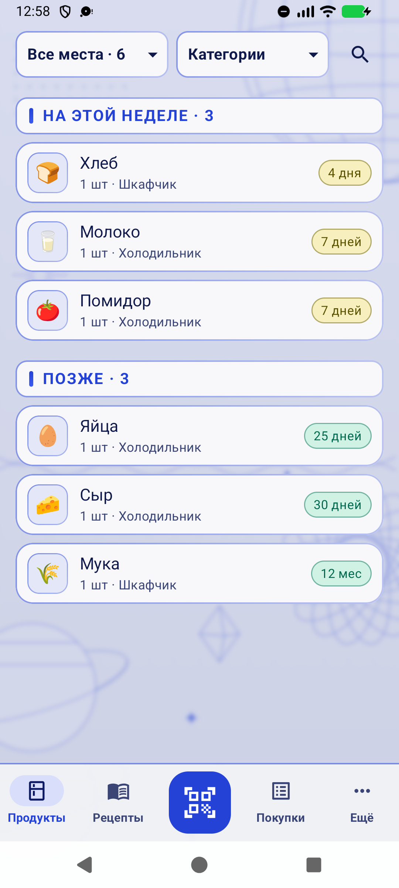
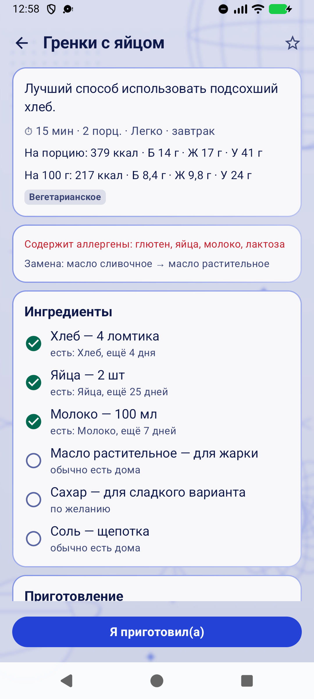
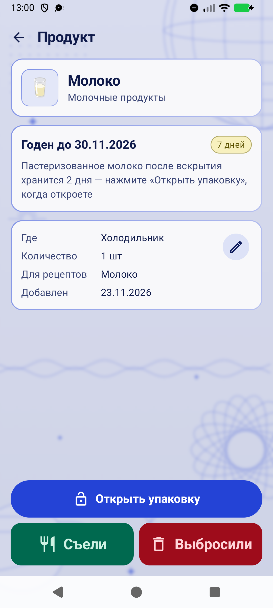
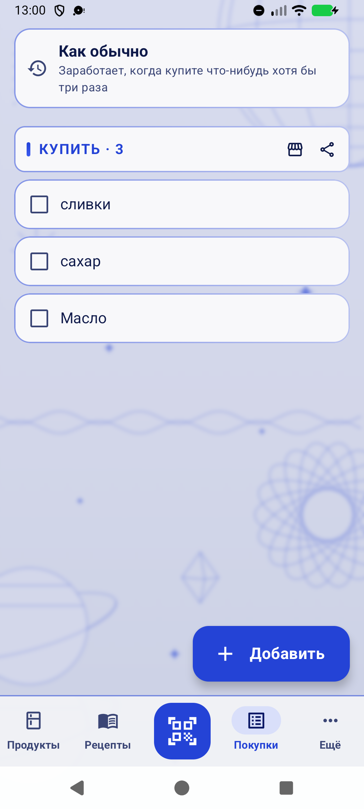
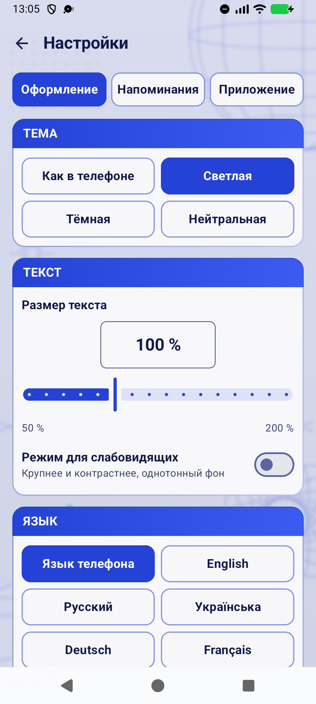
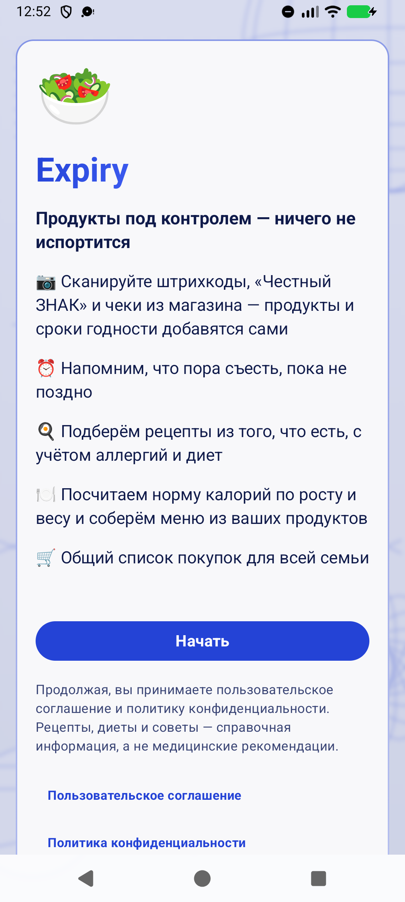
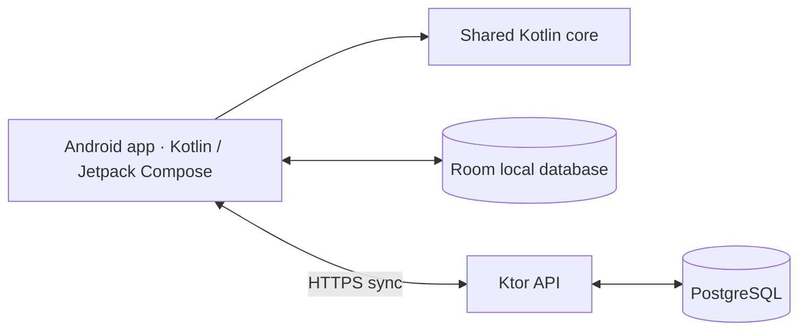

# Expiry

**Expiry — Android-приложение для домашнего учёта продуктов, рецептов и покупок.** Оно помогает ответить на три
простых вопроса: что уже есть дома, что нужно съесть первым и что приготовить из имеющихся продуктов.

Добавляйте продукты вручную или сканером, указывайте сроки и места хранения, а Expiry покажет, что скоро испортится,
подберёт рецепты из запасов и поможет собрать список покупок. Учёт запасов, рецепты и покупки доступны без регистрации
и интернета. Аккаунт нужен для синхронизации между устройствами и общего холодильника.

[Сайт проекта](https://expiryapp.ru)

## Что это даёт каждый день

- **Меньше забытых продуктов:** сроки годности и места хранения собраны в одном списке.
- **Понятнее, что приготовить:** рецепты показывают, какие ингредиенты уже есть и что придётся купить.
- **Проще планировать питание:** приложение рассчитывает ориентир калорий и составляет меню из домашнего запаса.
- **Удобнее покупать:** список покупок дополняют подсказки о продуктах, которые обычно заканчиваются.

## Скриншоты

Снимки сделаны в Android-эмуляторе на русском языке. Продукты и данные на экранах — демонстрационные.

  
  
  
  
  
  
  
  
  

## Возможности

- **Запасы и сроки годности.** Сортировка помогает сначала использовать продукты, которые испортятся раньше.
  Для открытой упаковки можно учитывать отдельный срок хранения.
- **Добавление продуктов.** Заполните карточку вручную или воспользуйтесь сканером штрихкодов, кодов маркировки
  и QR-кодов чеков.
- **Рецепты из того, что есть.** Поиск и фильтры помогают подобрать блюдо с учётом времени приготовления,
  вкусовых предпочтений и аллергенов. В карточке видно, что уже есть дома и чего не хватает.
- **Меню и питание.** План на 1, 3 или 7 дней учитывает продукты дома. Для взрослых приложение рассчитывает
  ориентир калорий и порций; результаты не заменяют медицинскую консультацию. Параметры роста, веса и возраста
  хранятся только на устройстве.
- **Покупки.** В список можно добавлять продукты вручную или из подсказок «Как обычно», основанных на ритме прошлых
  покупок.
- **Несколько холодильников.** Запасы разных холодильников не смешиваются; при входе в аккаунт можно синхронизировать
  их между устройствами и делиться общим холодильником.
- **Офлайн и настройки.** Основные сценарии работают без аккаунта. Интерфейс переведён на 12 языков, есть светлая,
  тёмная и нейтральная темы, настройка размера текста и режим для слабовидящих.

## Первый запуск

Можно начать без регистрации: продукты, рецепты и покупки останутся на этом телефоне. Аккаунт добавляет
синхронизацию, QR-коды чеков и общий холодильник.

  
  

## Архитектура

Телефон хранит данные локально; при входе в аккаунт сервер добавляет синхронизацию и общие холодильники.
Расчёты сроков, подбор рецептов и другие правила вынесены в отдельный Kotlin-модуль, который используют Android-клиент
и сервер.

## Технологии

Kotlin, Jetpack Compose, Room, Coroutines/Flow, Ktor, PostgreSQL, Gradle.

## English

Expiry is an Android app for keeping track of food at home and planning what to cook and buy. It helps answer three
everyday questions: what do I have, what should I use first, and what can I make with it? Add food manually or with
the smart scanner, track expiry dates and storage places, find recipes from available ingredients, and build a
shopping list.

The core inventory, recipe and shopping flows work offline without an account. Signing in adds optional sync between
devices and shared fridges. Meal planning uses food already at home; body measurements used for calorie estimates stay
on the phone. Nutrition information is for general guidance, not medical advice.

Expiry is built with Kotlin, Jetpack Compose and Room, with shared product and recipe rules in a pure-Kotlin core.
An optional Ktor/PostgreSQL backend handles sync and shared fridges.

This repository is a portfolio overview only. It contains no production source code, credentials, signing keys, user
data, or deployment configuration.
