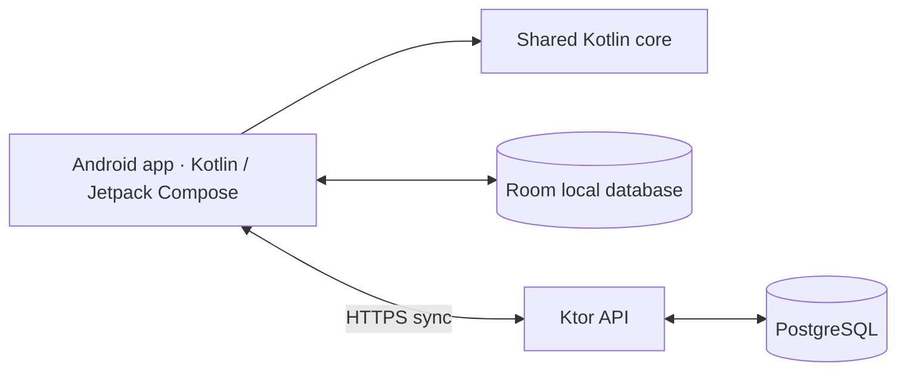

# Expiry

**Домашний учёт продуктов для Android:** сроки годности, покупки и блюда из того, что уже есть дома.

[Сайт проекта](https://expiryapp.ru)

## Возможности

- Учёт продуктов и сроков годности с офлайн-доступом.
- Добавление по штрихкоду и QR-коду кассового чека.
- Рецепты и меню на основе продуктов дома.
- Список покупок и несколько общих холодильников.
- Интерфейс на 12 языках, настройки крупного текста и доступности.

## Скриншоты

Снимки сделаны в Android-эмуляторе; продукты в списке — демонстрационные.

### Продукты

### Рецепты из продуктов дома

## Архитектура

Клиент работает локально, а серверная синхронизация подключается для резервной копии и общих холодильников.
Бизнес-правила вынесены в отдельный Kotlin-модуль, чтобы UI и сервер опирались на одну модель предметной области.

## Технологии

Kotlin, Jetpack Compose, Room, Coroutines/Flow, Ktor, PostgreSQL, Gradle.

## English

Expiry is a local-first Android app for tracking food and expiry dates, building shopping lists, and finding recipes
from ingredients already at home. It uses Kotlin, Jetpack Compose, Room, a shared Kotlin core, and a Ktor/PostgreSQL
backend for optional sync and shared fridges.

This repository is a portfolio overview only. It contains no production source code, credentials, signing keys, user
data, or deployment configuration.
