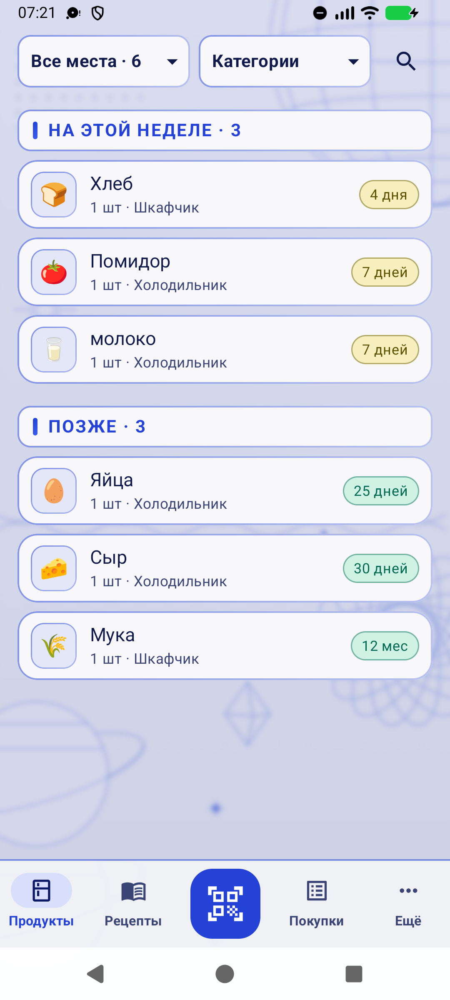
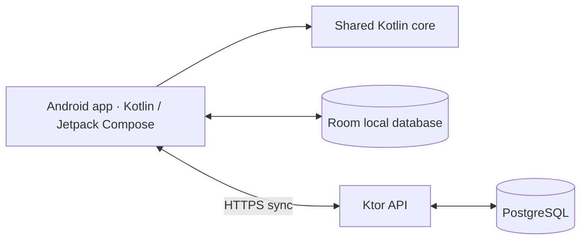

# Expiry

**Expiry — Android-приложение для домашнего учёта продуктов и планирования покупок.** Оно помогает быстро понять,
что уже лежит в холодильнике, что лучше съесть в первую очередь и какое блюдо можно приготовить из имеющихся
ингредиентов. Цель — меньше забывать продукты, покупать повторно то, что уже есть, и проще решать, что приготовить.

Вместо заметок и таблиц Expiry собирает продукты в одном списке, показывает их сроки и места хранения, напоминает о
том, что скоро закончится, и связывает запасы с рецептами и покупками. Основной сценарий работает локально и не
требует регистрации. Аккаунт нужен, если хочется синхронизировать данные между устройствами или вести общий
холодильник с близкими.

[Сайт проекта](https://expiryapp.ru)

## Что это даёт каждый день

- **Перед походом в магазин** можно посмотреть, что уже есть дома, и собрать список того, чего не хватает.
- **В холодильнике ничего не теряется:** у каждого продукта есть срок годности и место хранения, а список помогает
  заметить продукты, которые пора использовать.
- **Проще выбрать блюдо:** рецепты показывают, какие ингредиенты уже есть и что придётся докупить.
- **Покупки становятся предсказуемее:** приложение замечает продукты, которые обычно заканчиваются, по истории
  покупок и предлагает добавить их в список.

## Возможности

- **Запасы дома:** ручное добавление, сканирование штрихкодов и QR-кодов чеков; категории, количество и место
  хранения для каждого продукта.
- **Сроки годности:** даты на упаковке, сроки хранения после открытия и напоминания. Продукты можно сортировать,
  чтобы сначала использовать то, что портится раньше.
- **Рецепты из запасов:** поиск и фильтры по блюду, времени приготовления, предпочтениям и аллергенам. В карточке
  видно, что уже есть дома и чего не хватает.
- **Меню и питание:** план на 1, 3 или 7 дней из рецептов и продуктов дома; расчёт ориентировочной дневной нормы
  калорий и планирование порций.
- **Покупки:** обычный список и подсказки «Как обычно» на основе ритма прошлых покупок.
- **Несколько холодильников:** личные запасы отдельно друг от друга и общий холодильник с другими участниками.
- **Офлайн и доступность:** основные сценарии доступны без аккаунта; интерфейс переведён на 12 языков, есть
  крупный текст и режим для слабовидящих.

## Скриншоты

Снимки сделаны в Android-эмуляторе; продукты в списке — демонстрационные.

### Продукты

### Рецепты из продуктов дома

## Архитектура

Телефон хранит данные локально; при входе в аккаунт сервер добавляет синхронизацию между устройствами и общие
холодильники. Расчёты сроков, подбор рецептов и другие правила вынесены в отдельный Kotlin-модуль, который используют
и Android-клиент, и сервер.

## Технологии

Kotlin, Jetpack Compose, Room, Coroutines/Flow, Ktor, PostgreSQL, Gradle.

## English

Expiry is an Android app for keeping track of the food at home and planning what to cook and buy. It helps answer
three everyday questions: what do I have, what should I use first, and what can I make with it? Products can be added
manually, by barcode, or from a receipt QR code; the app tracks expiry dates and storage places, reminds the user about
food that needs attention, and finds recipes from available ingredients.

The core inventory and recipe flow works offline without an account. Signing in adds optional sync between devices
and shared fridges. Shopping suggestions are based on purchase history, and meal plans are built from the recipes and
food already at home.

Expiry is built with Kotlin, Jetpack Compose and Room, with shared product and recipe rules in a pure-Kotlin core.
An optional Ktor/PostgreSQL backend handles sync and shared fridges.

This repository is a portfolio overview only. It contains no production source code, credentials, signing keys, user
data, or deployment configuration.
